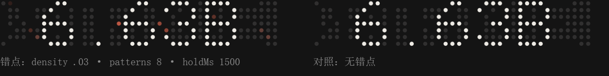

# 错点（glitch）效果

模拟 LED 屏刷新后残留的**鬼点**：每次闪烁切换后，屏上多出一批「不属于本内容」的亮点，
它们再闪烁一下才熄灭 —— 屏面恢复正确显示。



> 左：`density .03 · patterns 8 · holdMs 1500`（错点用 `--dm-glitch-ink` 染成红色便于观察，默认与正常点同色）；
> 右：同一时刻的对照（无错点）。两屏由同一份代码在同一页生成，相位一致。

## 1. 两个旋钮在调什么

| 参数 | 含义 | 直观效果 |
| --- | --- | --- |
| `density` | 每次切换后错点数 **占整屏格位的比例** | 「错点的多少」。`0.02` 在 41×7 = 287 格的屏上 ≈ 6 个错点/次；`0` = 关闭 |
| `patterns` | 错点集合 **多少轮切换才重复一次**（≥1） | 「随机性」。`1` = 每次都错同一批点；`8` = 连续 8 次切换各错一批，第 9 次回到第一轮；越大越"每次都不一样" |
| `holdMs` | 错点从亮起到熄灭的时长 | 错点「存活」多久才被第二次闪烁纠正（默认 260ms） |
| `seed` | 换一组错点的「性格」 | 同一 seed 输出**逐字节一致**（SSR/hydration 安全）；换个 seed 就换一批点 |
| `holes` | 正确点里「先缺后补」的比例（0–1） | 反向错点：该亮的点晚 `holdMs` 才亮，屏面先缺后补（不随 `patterns` 轮换） |
| `className` | 追加到错点元素上的 class | 单独给错点加样式；改色推荐用 CSS 变量 `--dm-glitch-ink` |

```tsx
<DotMatrix items={["STRIVE", "6.63B", "04Ting."]} glitch={{ density: 0.02, patterns: 8, holdMs: 260, seed: 3 }} />
```

```js
DotMatrix.create(items, { glitch: { density: 0.02, patterns: 8, seed: 3 } });   // vanilla
```

```html
<div data-dot-matrix='["STRIVE","6.63B"]' data-glitch='{"density":0.02,"patterns":8,"seed":3}'></div>
```

在线调：演示页第 ⑦ 张卡（`demo/index.html`）给了 density / patterns / holdMs / seed / holes 五个滑杆，
下方实时显示「每次切换约 N 个错点、错点节点 M 个、集合每 P 轮重复一次」。

## 2. 为什么不需要 JS（以及代价）

难点是「每次错不同的点」。纯 CSS 没有随机数，所以这里用**轮次分配 + 长周期动画**：

1. 对每个组，收集候选格位 = 「本组未点亮、且不是全组共用」的格子（共用的点常亮，错点看不出来）；
2. 用**带种子的确定性洗牌**（mulberry32 + Fisher–Yates）把候选点打乱；
3. 取前 `每轮错点数 × patterns` 个进「池」，第 i 个点分配轮次 `p = i mod patterns`；
4. 每个错点是一条独立元素，动画时长 = `patterns × 周期`，延迟 = `p × 周期 + 组相位 + 列相位`；
   它的 keyframes 只在前 `holdMs` 亮起（带一次抖动），其余时间为 0。

于是：**第 p 轮切换时，只有轮次为 p 的那批点亮起** —— 每轮换一批、`patterns` 轮后重复，
而每轮的点数恒为 `每轮错点数 = round(density × 整屏格位)`。`density` 与 `patterns` 因此互不干扰。

代价是 DOM：池大小 = `每轮错点数 × patterns × 组数`。所以「随机性」是拿节点数换的：

| density | patterns | 组数 | 错点节点 | 相对原 333 个圆点 |
| --- | --- | --- | --- | --- |
| 0.02 | 1 | 3 | 18 | +5% |
| 0.02 | 8 | 3 | 144 | +43% |
| 0.03 | 16 | 3 | 432 | +130% |

> 实测（CDP `Performance.getMetrics`）：333 个动画元素的主线程开销约 0.039 s/5 s；
> 错点是同类的 opacity 动画，且**绝大多数时间 opacity 为 0**，加几百个节点仍在可接受范围。
> 若嫌重，优先降 `patterns`（随机性）而不是 `density`（观感）。

## 3. 时间轴

以 `n = 3`（周期 15 000ms、每组 5 000ms）、`patterns = 8`、`holdMs = 300` 为例：

```
第 1 轮                                                     第 2 轮
├─ 组 0 时段 ──┤├─ 组 1 时段 ──┤├─ 组 2 时段 ──┤   ...   ├─ 组 0 时段 ──┤ ...
0ms      5000        10000       15000                   15000
│
├ 0ms      : 组 0 的 6 个错点亮起（+ 列相位 22ms×col）
├ 0→900ms  : 正常字形按列扫掠重组
├ 300ms+   : 错点各自闪烁一下后熄灭（=「再次闪烁才恢复正确」）
└ 5000ms   : 进入组 1 时段，轮到组 1 的错点
```

错点动画周期 = `8 × 15000ms = 120000ms`，即第 p 轮的错点在 `p × 15000ms` 亮起，
8 轮（120s）后整套错点集合重复。

## 4. 边界与取舍

- **`prefers-reduced-motion`**：错点被整体禁用（`animation: none; opacity: 0`）——闪烁效果对前庭敏感人群不友好。
- **no-JS / SSR**：错点完全由 CSS 表达，服务端就能算出同一批点（确定性伪随机），无需客户端补渲染。
- **轮次上限**：若候选点太少（屏窄或 `density` 很大），有效轮次会被自动压到
  `floor(候选点数 / 每轮错点数)`，避免「同一轮里出现重复点」。
- **`holes` 不随 `patterns` 轮换**：它是把正确点的 `animation-delay` 推后 `holdMs`，一个点只有一条动画，
  无法按轮次切换；要让它也轮换需要 JS 每轮改 class（见下）。
- **`holdMs` 建议 < 每组时长**（5000ms），否则错点会跨到下一组时段；超过时百分比会被夹到 99%。
- **同一格位可能服务多个组**：某个点对组 0 是错点、对组 1 是正常点，两者时段不同、互不冲突。

## 5. 想要「真正每次都不同」？

CSS 版本的随机性是**周期性**的（`patterns` 轮一循环）。若要做到「永不重复」，
需要一个每轮改 class 的 JS 钩子（在每组时段开始时重新抽样），代价是：

- 失去 no-JS 能力（不过错点本就是装饰，无 JS 时退回干净屏面，属于优雅降级）；
- 每个实例一个定时器 / `animationiteration` 监听 + 每轮几十次 class 切换。

当前实现**没有**引入它。需要的话说一声，可以在 `glitch.mode: "live"` 下补上，两种模式共用同一套参数。

---

## 6. 错点作为「状态语言」（构想清单）

同一个效果换参数就是另一种**状态语义** —— 装饰变成信息：屏面的「稳定程度」直接表达数据可信度，
比再加一行文字状态更省空间、也更像一台真设备。演示页第 ⑧ 栏把前四种并排放在一起看。

### 已可直接接入（用现有参数，站点侧只改调用处）

| # | 状态 | 参数 | 观感 |
| --- | --- | --- | --- |
| 1 | **正常**（hub 在线、数据新鲜） | `density .015 / patterns 8 / holdMs 140` | 偶发孤点，屏「活着」但不吵 |
| 2 | **刷新瞬间**（数值刚更新） | `density .035 / patterns 1 / holdMs 120` | 一次短促爆发 = 信号刷新 |
| 3 | **实时停更**（曾拿到实时值，之后失败） | `density .03 / patterns 2 / holdMs 300` | 开始不稳，但仍大体可读 |
| 4 | **快照兜底**（hub 拉不到，用快照仓库） | `density .045 / patterns 1 / holdMs 480` | 同几处坏点反复闪 = 「卡住的坏点」 |
| 5 | **离线**（三层都失败） | `density .06 / patterns 1 / holdMs 620` + `gutter.online:false` | 持续故障 + 右列告警灯 |
| 6 | **首次加载 / 骨架** | 从 `density .08` 衰减到 0（配 `boot`） | 信号建立中 → 稳定 |
| 7 | **错误 / 失败态** | `density .1 / holdMs 1500` | 屏「坏了」，一眼看出异常 |
| 8 | **深夜 / 低活跃** | `density .008 / patterns 16` | 偶发孤点，安静 |
| 9 | **打卡中断** | 一次性 `density .08 / holdMs 1200` | 一次「故障」，之后恢复 |
| 10 | **里程碑达成** | 一次性 `density .05 / patterns 1 / holdMs 200` | 庆祝性的静电 |
| 11 | **主题切换** | 一次性爆发 | 像「重新上电」 |
| 12 | **从后台标签页切回** | 一次性爆发 | 像「重新同步」 |
| 13 | **网络重连** | `density` 从 .06 衰减到 .015 | 屏面「稳定下来」 |
| 14 | **午夜 / 日期翻转** | 一次性爆发 | 一天的边界 |
| 15 | **数值下降** | 提高 `holes`（如 .08） | 「缺」的感觉，与增长相反 |

### 需要额外机制（本批未做，记在这里）

| # | 状态 | 缺什么 |
| --- | --- | --- |
| 16 | **数值上升/下降分开表达** | 目前错点是整屏的；要做到「只有数值组出错」需要 **per-group glitch**（候选点按组限定） |
| 17 | **hover / 点击反馈**（接触不良） | 需要一个交互钩子（`onPointerEnter` 改 `density`），或宿主自己改参数重渲染 |
| 18 | **随音乐节拍** | 需要 WebAudio 分析（站点已有 NowPlaying，但拿不到音频流）；远期 |
| 19 | **错点随积压量线性增长** | 需要把业务量映射到 `density` 的适配层（站点侧一行） |

> 原则：**同一套参数、不同的映射**。加状态时优先想「这件事在真机上会表现成什么样」，
> 而不是再加一个文字标签。落地写法见 [site-upgrade.md](site-upgrade.md) 第一节的 `GLITCH_BY_TIER`。
