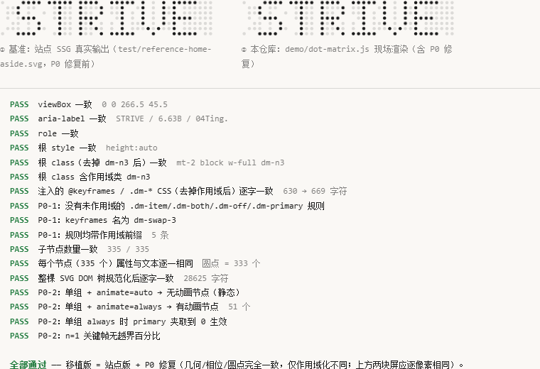

# 校验：移植版与原版是否一致

结论：**一致**。`demo/dot-matrix.js` 与站点 SSG 输出的真实 SVG 在 DOM 层面逐字一致，
并排渲染的像素差为 15 600 像素中的 4 个（最大通道差 8/255，亚像素抗锯齿）。



## 1. 对照基准从哪来

`test/reference-home-aside.svg` 是从站点构建产物里**原样截取**的真实 SVG（不是手写样本）：

```powershell
# 从 personal-site 的 SSG 产物 out/index.html 里截出含 dm-item 的那个 <svg>
$html = [System.IO.File]::ReadAllText("P:\personal-site\out\index.html", [System.Text.Encoding]::UTF8)
$i    = $html.IndexOf('dm-item')
$svg  = $html.Substring($html.LastIndexOf('<svg', $i), $html.IndexOf('</svg>', $i) + 6 - $html.LastIndexOf('<svg', $i))
[System.IO.File]::WriteAllText("reference-home-aside.svg", $svg, (New-Object System.Text.UTF8Encoding($false)))
```

该基准的规模：`viewBox="0 0 266.5 45.5"`（41 列 × 7 行）、333 个圆点、2 个 `<style>`/`<title>` 子节点、
`aria-label="STRIVE / 6.63B / 04Ting."`、注入 CSS 630 字符。

## 2. 复跑步骤

```powershell
cd dot-matrix
python -m http.server 8123 --bind 127.0.0.1      # file:// 下 fetch 会被拦截，必须走本地服务
```

浏览器打开 <http://127.0.0.1:8123/test/compare.html>：左侧是基准 SVG（与浏览器消费站点 HTML 的路径一致，
用 `text/html` 解析），右侧是 `demo/dot-matrix.js` 现场渲染的版本，下方逐项给出 PASS/FAIL。

命令行版（headless Chrome 截图 + 读判定文本）：

```powershell
$chrome = "C:\Program Files\Google\Chrome\Application\chrome.exe"
& $chrome --headless=new --disable-gpu --hide-scrollbars --window-size=760,460 `
  --virtual-time-budget=4000 --screenshot=test\compare-result.png `
  "http://127.0.0.1:8123/test/compare.html"

& $chrome --headless=new --disable-gpu --virtual-time-budget=4000 --dump-dom `
  "http://127.0.0.1:8123/test/compare.html" > dom.html   # 从 <div id="verdict"> 里读 PASS/FAIL
```

## 3. 判据与结果

| 判据 | 结果 | 细节 |
| --- | --- | --- |
| 根元素 `viewBox` | PASS | `0 0 266.5 45.5` |
| 根元素 `aria-label` | PASS | `STRIVE / 6.63B / 04Ting.` |
| 根元素 `role` | PASS | `img` |
| 根元素 `style` | PASS | `height:auto` |
| 根 class（去掉 `dm-n3` 后） | PASS | 一致，且必须含 `dm-n3` |
| 注入的 `@keyframes` + `.dm-*` 规则（去掉作用域后） | PASS | 逐字一致，630 → 669 字符（差额 = 作用域前缀） |
| P0-1 守卫 | PASS | 无未作用域规则；keyframes 名 `dm-swap-3`；5 条规则均带 `.dm-n3 ` 前缀 |
| 子节点数量与顺序 | PASS | 335 / 335 |
| 每个节点的 `cx/cy/r/class/style` 与文本 | PASS | 335 个逐一相同（其中圆点 333 个） |
| 整棵 DOM 树规范化序列化（抹平作用域化差异） | PASS | 逐字一致，28 625 字符 |
| P0-2 守卫 | PASS | 单组 `auto` 无动画节点 / `always` 有 51 个；n=1 关键帧无越界百分比 |
| 并排渲染像素差 | PASS | 4 / 15 600 像素，最大通道差 8/255 |

> 本仓库含 P0 修复，所以判据是**「抹平作用域化差异后逐字一致」**，抹平的三处差异是：
> keyframes 名后缀（`dm-swap-3` → `dm-swap`）、规则作用域前缀（`.dm-n3 ` → 空）、根 class 里的 `dm-n3` 记号。

> 三个坑（`compare.html` 里已处理）：
> ① 用 `image/svg+xml` 解析基准会把 `<style>` 当普通文本渲染出来 —— 必须用 `text/html` 解析，
> 才与浏览器消费站点产物的路径一致；
> ② XML 序列化器把空元素写成 `<circle/>`、HTML 序列化器写成 `<circle></circle>` —— 所以「最强判据」
> 用的是自建的规范化序列化（属性名排序 + 递归文本），而不是 `innerHTML` 直接比较；
> ③ 属性序列化是 `name=value | name=value`（不带引号），归一化正则要按这个格式写，别按 `class="…"` 写。

## 4. 动画相位探针

`test/phase-probe.html` 采样第 2 组（数值组）每个圆点的 `getComputedStyle(opacity)`，用来核对
「组相位 + 列相位」时序。headless Chrome 的**虚拟时间与动画时钟起点并不相同**，因此截图取相位前
先用它标定；同一份页面在不同预算下实测到的相位（`ITEM_MS = 5000ms`，三组周期 15 000ms）：

| 虚拟时间预算 | 屏面状态 |
| --- | --- |
| 2 000 ms | STRIVE 扫掠中（左段已亮、右段未亮） |
| 4 000 ms | STRIVE 全亮 |
| 6 000 / 8 000 ms | 6.63B 全亮 |
| 10 000 / 12 000 ms | 组间过渡（近乎全灭） |
| 14 000 ms | 04TING. 全亮 |

即三组按 `STRIVE → 数值 → 署名` 的顺序、每组 5s 轮换，与组件里的 `ITEM_MS = 5000` 及
`animation-delay = k × 5000 + col × 22 ms` 完全对应。注：该探针在虚拟时间下 `getComputedStyle`
读到的动画值可能恒为基准值（`opacity: 0`），因为动画走的是合成器时钟——**要观察相位请用截图**，
不要用探针的数值输出。

## 5. 复现环境

- Chrome `--headless=new`（Windows），`--window-size=760,460`，DPR = 1
- Python 3（`http.server`）仅用于提供静态文件
- 截图与像素差用 Pillow：把并排两块屏按固定坐标裁剪（左 `0..300`、右 `340..640`，高 52px）后 `ImageChops.difference`
- **预览图用 `test/shot.mjs` 产出**（CDP + 真实等待）：`node test/shot.mjs <url> <out.png> [waitMs] [w] [h] [scale]`。
  不用 `--virtual-time-budget` 截图的原因见 §4：虚拟时间不推进 CSS 动画时钟，相位不可复现

## 6. P0 回归探针

`test/p0-regression.html` 用 12 项断言覆盖 P0 修复后的行为（同页放 2 组 / 3 组 / 单组两种实例）：

```
PASS  P0-1 实例 A（2 组）animation-duration = 10s     · 实际 10s
PASS  P0-1 实例 B（3 组）animation-duration = 15s     · 实际 15s
PASS  P0-1 keyframes 按组数命名                       · dm-swap-1, dm-swap-1, dm-swap-2, dm-swap-3
PASS  P0-1 不存在未加组数后缀的 dm-swap
PASS  P0-1 不存在未作用域的 .dm-item/.dm-both/.dm-off/.dm-primary 规则   · 0 条
PASS  P0-2 单组 + animate=always 有动画节点 / 周期 = 5s
PASS  P0-2 单组 + animate=auto 保持静态（无动画节点，亮点走 dm-both）
PASS  P0-2 n=1 关键帧无越界百分比、无重复百分比
PASS  P0-3 primary=99 被夹取到最后一组（dm-i2）
```

修复前同一探针的实测（站点版行为）是「实例 A（2 组）animation-duration = 15s 期望 10s 错」，
即 [../docs/improvements.md](../docs/improvements.md) §1 记录的 P0-1。

站点组件（`personal-site/components/DotMatrix.tsx`）仍是旧行为；本仓库用
[`../patches/0001-p0-scoped-keyframes.patch`](../patches/0001-p0-scoped-keyframes.patch) 记录逐行差异
（已验 `git apply` 后与本仓库 `src/DotMatrix.tsx` 逐字节一致）。

## 7. 错点效果探针

`test/glitch-probe.html` 用 17 项断言覆盖错点效果（`density / patterns / holdMs / seed / holes`）：

```
PASS  ① 默认不传 glitch → 无错点节点、CSS 里无 dm-glitch 规则、圆点数仍为 333（回归保护）
PASS  ② patterns=1：错点数 = 每轮数 × 组数（18 = 6 × 3）；所有错点都在第 0 轮；动画时长 = 1 × 周期
PASS  ③ patterns=8：出现 8 个不同轮次，每轮错点数相等，动画时长 = 8 × 周期 = 120000ms
PASS  ④ 错点只落在「本组未点亮、且非全组共用」的格位上（非法 0 个）
PASS  ⑤ 同 seed → 输出逐字节一致（SSR/hydration 安全）；换 seed → 同一轮次的错点集合不同
PASS  ⑥ 只开 holes → 不产生错点节点，而是把部分正确点的延迟推后（先缺后补）
PASS  ⑦ 错点在 prefers-reduced-motion 下被禁用
```

语义、算法与 DOM 代价见 [../docs/glitch.md](../docs/glitch.md)。
